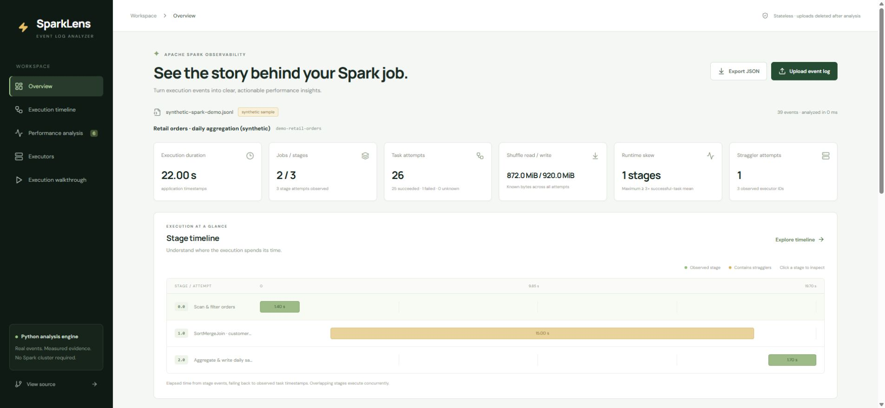
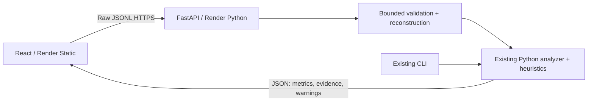

# SparkLens — Spark Event Log Analyzer

A Python Spark performance analyzer with FastAPI and an interactive React + TypeScript dashboard. Upload an actual Spark log, reconstruct jobs/stages/task attempts, inspect shuffle and skew evidence, and follow an execution walkthrough. No Spark cluster or database.

Existing Python logic, Git history, CLI commands, JSON/Markdown reports and all six diagnostic rules are preserved.



## Try it

See [verified deployment status and live URLs](docs/DEPLOYMENT_STATUS.md). Frontend: Render Static Site. API: separate Render Python service. A free backend can take about a minute to wake.

1. Choose **Explore synthetic sample**. It remains labeled synthetic; the Python engine computes its actual fixture metrics.
2. Overview shows duration, jobs/stages, task outcomes, traffic, skew and stragglers.
3. Select stage **1.0** in the timeline. Inspect task runtimes, shuffle reads and parent-stage links. Filter stragglers/failed attempts.
4. Performance analysis shows stage-specific evidence and recommendations. Executors shows measured per-executor work.
5. Execution walkthrough navigates seven steps forward/back. It is illustrative playback of completed analysis, not live processing telemetry.
6. Upload a real log using **Upload event log** → **Choose file** or drag-and-drop. A successful report replaces the sample. Completeness notes describe missing measurements.
7. **Export JSON** saves the current structured report. The server retains no uploads or reports.

## Supported input

One application's **uncompressed UTF-8 JSON Lines**, one listener event object per line. File extensions are not trusted. For simple exports, set `spark.eventLog.enabled=true`, `spark.eventLog.compress=false`, `spark.eventLog.rolling.enabled=false` before a run, then retrieve its file from `spark.eventLog.dir`. Decompress existing logs first. Rolling logs require an ordered single-application JSONL export; directories/archives are unsupported. See [Spark monitoring](https://spark.apache.org/docs/latest/monitoring.html).

Limits: **25 MiB**, **150,000 events**, **25,000 task attempts**, **2,000 jobs/stage attempts**, **1 MiB per event line**. One request at a time; overlaps receive 429. Upload deadline 60s; cooperative analysis deadline 30s. Invalid JSON/numbers and metadata-only logs receive meaningful errors. Partial execution logs can be analyzed with completeness warnings.

The [synthetic sample](src/spark_perf_analyzer/data/demo.jsonl) contains 2 jobs, 3 stages, 26 attempts, 25 successes, 1 failure, 22s application elapsed, 872 MiB shuffle read and 920 MiB write. These are fixture values, not a benchmark or speedup. `scripts/generate_sample.py` reproduces it. The original [CLI fixture](sample_data/mock_event_log.jsonl) remains. Compatibility tests include an attributed [Apache Spark upstream fixture](tests/fixtures/NOTICE.md).

## Local setup

Python 3.10+; CI uses 3.10/3.11/3.12. Node 24, pnpm 10.28.2. Render pins Python 3.12.

```sh
python -m venv .venv
# Activate .venv in your shell, then:
python -m pip install -e '.[dev]'
uvicorn spark_perf_analyzer.api:app --host 127.0.0.1 --port 8000 --no-access-log
```

In another terminal:

```sh
cd frontend
npx --yes pnpm@10.28.2 install --frozen-lockfile
npx --yes pnpm@10.28.2 dev
```

Open `http://127.0.0.1:5173`. Vite proxies API requests to port 8000. Separate origins require frontend build-time `VITE_API_BASE_URL` and API startup `ALLOWED_ORIGINS`; examples are included. Vite variables are public.

## Existing CLI

```sh
spark-perf-analyzer sample_data/mock_event_log.jsonl --format markdown --output report.md
spark-perf-analyzer sample_data/mock_event_log.jsonl --format json --shuffle-threshold-mb 256 --skew-ratio-threshold 2
```

The CLI runtime remains dependency-free. Install `[web]` for HTTP, `[dev]` for tests. The legacy CLI aggregates by stage ID; the web adapter separates attempts and uses successful-partition baselines. CLI `duration_ms` now uses observed task timestamps, or zero when absent in its legacy schema; web elapsed time is null when unavailable.

## Validation

```sh
python -m pytest
cd frontend
pnpm test
pnpm build
# Repository root:
python scripts/benchmark.py
python scripts/verify_deployment.py --frontend FRONTEND_URL --backend BACKEND_URL --large
```

GitHub Actions runs Python tests across 3 versions, frontend behavior tests and strict TypeScript/Vite build. Tests cover the original CLI, real task-result objects, elapsed time, retries, attempts, skew/shuffle calculations, missing metrics, invalid input, limits, timeouts, cleanup, endpoints and CORS. A 10,000-task parser test and 25,000-task benchmark/live verifier check larger inputs. Actual evidence is in [deployment status](docs/DEPLOYMENT_STATUS.md).



- [Architecture, complexity and failure handling](docs/ARCHITECTURE.md)
- [Interview guide: reconstruction, shuffle, skew and tradeoffs](docs/INTERVIEW_GUIDE.md)
- [Render configuration, cost and operations](docs/HOSTING.md)

Findings are investigation candidates, not causal proof or guaranteed speedups. Missing task metrics are null; aggregate totals sum known values. Runtime skew does not prove key skew; high shuffle does not prove network saturation. No SQL operator-plan reconstruction, rolling-directory merge, compressed codecs, authentication, durable reports or SLA. Free hosting can sleep/restart or hit shared quotas. Upload only logs you are authorized to share; workload/stage names appear in reports.

MIT for this project; the upstream fixture retains its separate Apache 2.0 attribution and license.
