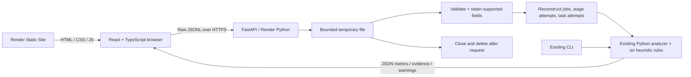

# Architecture

One repository, two Render services, no Spark runtime or database. Original models, analyzer, heuristics, parser, CLI and reporting modules remain. The web adapter reuses task normalization, stage aggregation and all six diagnostic rules, refining successful-partition baselines, stage-attempt separation and timestamp handling. CLI commands and report formats remain available.

## Boundaries

- `parser.py`: existing CLI JSONL reader and extraction helpers; validates event object shape.
- `analyzer.py`: common task normalization and stage aggregation. Object-shaped task reasons and nearest-rank p95 are handled; elapsed duration no longer sums parallel tasks.
- `web_analysis.py`: bounded ingestion, selective field retention, reconstruction, metric completeness and presentation contract.
- `heuristics.py`: existing threshold rules and evidence/recommendations.
- `api.py`: limits, exact-origin CORS, request IDs, admission control, cleanup, safe errors and samples.
- `frontend/src`: typed API client, stage/task charts, pagination and illustrative walkthrough.

API routes: `GET /health`, `GET /api/config`, `GET /api/sample`, `GET /api/sample/download`, `POST /api/analyze`. Interactive route documentation is at `/docs`. Upload the raw file body as `Content-Type: application/octet-stream`, not multipart. Example: `curl --data-binary @events.jsonl -H 'Content-Type: application/octet-stream' https://BACKEND/api/analyze`.

## Resources and failures

Raw requests stream into an OS temporary file while enforcing 25 MiB, including requests without Content-Length. Context-managed closure removes it after success, parse failure, timeout or disconnect. No file contents, names, query strings or client identifiers enter application logs. Logs contain random request ID, method, status and elapsed time. The API retains no reports between requests; the browser keeps its current report in memory. Exported reports may include workload and stage names from the log.

Only one upload/analysis is admitted per Uvicorn process; overlapping requests receive 429. Keep `--workers 1`: the flag is process-local. Parsing runs off the async loop, leaving health/config available. Upload deadline: 60 seconds. Ingestion and stage processing check a 30-second monotonic deadline. This is cooperative, not an OS hard-kill sandbox. An individual JSON parse is bounded by 1 MiB. Caps: 150,000 events, 25,000 task attempts, 2,000 jobs/stage attempts. Repeated task/stage events may hit event caps before unique-record caps. Uvicorn also limits HTTP concurrency.

Complexity: parsing O(B); indexing O(E + T); stage/job association O(S×J), both capped at 2,000; percentile sorting O(T log T); selected-stage task sorting O(T log T). Retained memory is O(T + supported E + S + J), bounded by upload/record limits. Input lines stream, but normalized supported events and results are retained; this is not constant-memory or multi-gigabyte analysis. The response includes all retained task attempts. Stage/task views paginate rendering. No uploaded content executes as code, shell commands or Spark jobs.

Horizontal scaling can run identical stateless instances with independent admission. Larger histories would justify incremental aggregation, paginated stored results, async jobs and explicit retention; this portfolio app avoids those dependencies. Free Render may sleep/restart and provides no availability SLA.
