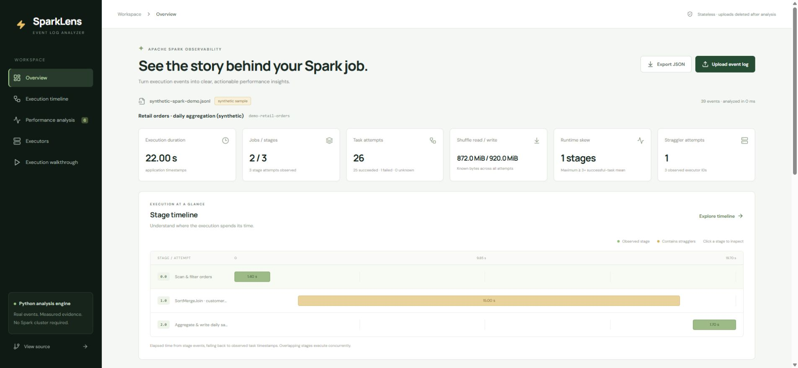

# Verified deployment — November 7, 2026

| Resource | Verified URL |
|---|---|
| Luxury gold dashboard | https://sparklens-ajaynalla.onrender.com |
| Python backend | https://sparklens-api-ajaynalla.onrender.com |
| Health | https://sparklens-api-ajaynalla.onrender.com/health |
| API documentation | https://sparklens-api-ajaynalla.onrender.com/docs |
| Repository | https://github.com/ajaynalla/spark-event-log-analyzer |

Both resources were observed deployed in the SparkLens Blueprint in the existing Render workspace. The Python service is **Free**, Virginia; the frontend is a Render Static Site. No paid resources or payment method were added. RateLab was not modified.

The backend health response reports runtime commit `10144c4acdefcf699ec6b2d2085ebde7f6a94599`. The luxury frontend is commit `5605b3865606a8917907aae011cb4d3e2c612e35`. Both deployed JS and CSS assets match the local production build byte for byte with the same public API origin; see [asset hashes and backend revision](release-verification.json). Documentation-only follow-up commits do not rebuild either runtime because of build filters.

## Automated validation

[Successful CI run for the luxury redesign](https://github.com/ajaynalla/spark-event-log-analyzer/actions/runs/42398005327):

- 39 Python analyzer/API tests on Python 3.11, 3.12 and 3.13.
- The original 3 CLI/analyzer tests also pass independently on Python 3.10.
- 8 frontend behavior/formatting/error tests and strict TypeScript/Vite build.
- The frontend dependency audit reported no known vulnerabilities for the checked lockfile.

That is 47 distinct tests, with Python tests repeated across supported versions. The backend test client emits a dependency deprecation warning about future HTTPX migration; tests pass.

[Public HTTP verification](live-verification.json) passed 11 checks against Render: health, configured limits, sample analysis/download, sample upload equality, sanitized upstream Spark fixture upload, invalid JSON (422), unsupported multipart (415), exact frontend CORS, frontend HTML and a 25,000-task upload. Only disposable fixtures were uploaded.

The supported-boundary upload was 10,480,560 bytes, with 25,000 tasks and exact asserted shuffle totals. Server analysis took **6,108.16 ms**; end-to-end request/response took **12,427.9 ms** in that run. This is a measured example on free hosting, not a throughput guarantee. The [local standalone benchmark](local-benchmark.json) measures a separate 25,000-task fixture, including JSON response encoding; it excludes HTTP/server overhead and is not a cloud memory measurement.

## Browser verification

The public luxury dashboard loaded data from the actual Python backend and showed the expected synthetic fixture values: 2 jobs, 3 stages, 26 attempts, 25 successes, 1 failure, 22 seconds, 872 MiB shuffle read and 920 MiB write. Synthetic data remained explicitly labeled.

Verified interactions: select stage 1.0; inspect 15-second stage elapsed versus 25.15 seconds of summed task runtime; filter one straggler (task 15, 14.5 seconds, 600 MiB read); filter the FetchFailed attempt; switch to task execution timeline; follow Stage 0's parent link; navigate all seven walkthrough steps and back from step seven. The included screenshot shows the same luxury build in local browser QA.

The Chrome automation file-chooser helper lacked its file-URL permission, and subsequent native-browser verification was stopped because Windows could not confidently determine the active browser URL. Therefore actual browser file-picker selection, browser export download, and a mobile viewport were not fully verified in this session. Raw HTTP uploads and frontend selected-File behavior are separately tested; the hosted sample verified frontend/backend integration. These are validation limits, not observed failures in the application upload endpoint.

## Cost and limits

Estimated cost is **$0/month within shared free usage**. The workspace had no card on file. Its included allowances were 750 free web hours, 5 GB bandwidth and 500 build minutes per month, shared with RateLab. The backend sleeps after inactivity and can take about a minute to wake. See [Render free limits](https://render.com/docs/free) and [hosting configuration](HOSTING.md).

Supported input is uncompressed UTF-8 JSONL for one application, up to 25 MiB/150,000 events/25,000 task attempts/2,000 jobs or stage attempts/1 MiB per event. One analysis slot; overlapping requests receive 429. No authentication, persistent report storage, compressed codecs, rolling-directory merge, SQL operator plan or SLA. Completeness notes distinguish missing measurements from measured zero. Rules identify investigation candidates, not guaranteed causes or speedups. The safe upstream test derivative removes environmental metadata and retains only numeric evidence and explicit test labels.
